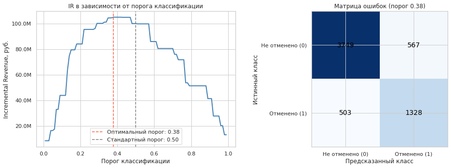
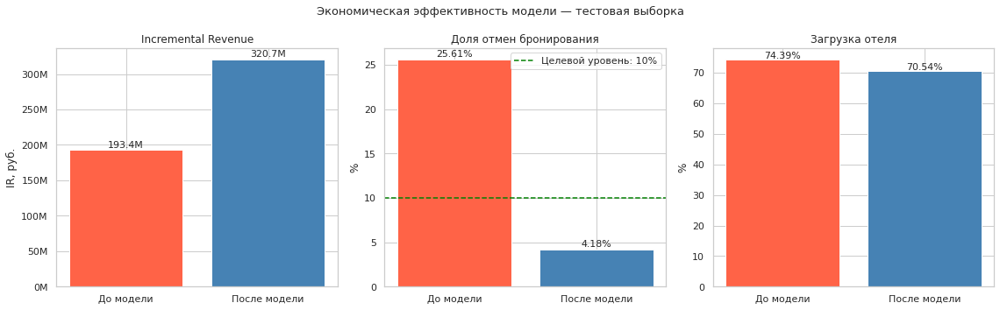

# Прогнозирование отмены бронирования отеля

Модель машинного обучения для оценки вероятности отмены бронирования в сети отелей UrbanStay. Цель проекта: заменить практику овербукинга точечным перебронированием номеров, которые с высокой вероятностью освободятся, и тем самым увеличить выручку (метрика Incremental Revenue, IR) без роста репутационных рисков.

## Результаты

Оценка выполнена на хронологически отложенной тестовой выборке (6 147 бронирований). Модель: Random Forest с изотонической калибровкой вероятностей и порогом классификации 0.38.

| Показатель | До модели | После модели | Динамика | Целевой уровень | Статус |
|---|---|---|---|---|---|
| Incremental Revenue, руб. | 193 435 500 | 320 701 500 | +65.79% | не менее +50% | достигнут |
| Доля отмен | 25.61% | 4.18% | -83.67% | не более 10% | достигнут |
| Загрузка отеля | 74.39% | 70.54% | -5.18% | снижение не более 8% | достигнут |

Метрики классификации на тестовой выборке при пороге 0.38: Precision 0.8475, Recall 0.8367, F1 0.8421, ROC-AUC 0.9753.





Перед использованием результатов прочитайте раздел [Ограничения](#ограничения).

## Данные

Данные хранятся в PostgreSQL и в репозиторий не включены. Результаты выполнения сохранены в выводах ячеек ноутбука.

| Таблица | Строк до очистки | Строк после очистки | Содержание |
|---|---|---|---|
| `hotel_bookings` | 35 341 | 30 733 | история бронирований (17 столбцов), целевая переменная `booking_status` |
| `hotel_reviews` | 25 177 | 21 883 | отзывы клиентов: оценка и текст |

Доля отмен в данных: 28.8% (8 850 из 30 733).

## Методология

1. **Загрузка и очистка.** Удаление 4 608 дубликатов бронирований и 3 294 дубликатов отзывов (оставлен последний отзыв по брони), обработка выбросов методом винзоризации по правилу IQR, замена нулевой стоимости брони медианой по типу номера.
2. **Объединение таблиц.** `pd.merge_asof`: для каждой брони подтягивается ближайший предыдущий отзыв клиента (`review_date <= booking_date`).
3. **Признаки.** Семь инженерных признаков (сезонность, лояльность, длительность и стоимость ночи, флаг раннего бронирования, наличие отзыва) и TF-IDF по текстам отзывов (50 токенов). Векторизация вынесена в пайплайн, чтобы исключить утечку между фолдами.
4. **Разбиение.** Хронологическое: обучающая выборка 60% (2017-01-01 - 2019-11-30), калибровочная 20%, тестовая 20% (2020-09-20 - 2025-10-22).
5. **Моделирование.** Random Forest и CatBoost, подбор гиперпараметров Optuna (30 испытаний, `TPESampler(seed=42)`), оптимизируемая метрика IR, кросс-валидация `TimeSeriesSplit(n_splits=3, test_size=2000)`.
6. **Калибровка.** Сравнение Sigmoid и Isotonic на калибровочной выборке (Brier Score: 0.12618 без калибровки, 0.11886 Sigmoid, 0.11639 Isotonic).
7. **Порог.** Перебор порогов от 0.01 до 0.99: порог 0.38 даёт IR 104 875 500 руб. против 99 854 500 руб. при пороге 0.5.
8. **Интерпретация.** `feature_importances_` и SHAP. Наиболее важные признаки: `days_until_checkin` (0.241), `has_review` (0.208), `sales_channel` (0.106), `child_count` (0.081), `previous_no_shows` (0.061).

### Экономическая метрика

Параметры задаются условиями задачи: `AVG_REV = 64 500` руб. (доход от номера), `LOST_REV = 64 500` руб. (потеря от отмены), `PER_REBOOKING = 45 000` руб. (доход от повторной сдачи номера), `COST_FP = 7 000` руб. (издержки ложного срабатывания).

```
IR_до    = N_заездов * AVG_REV - N_отмен * LOST_REV
IR_после = TP * PER_REBOOKING + TN * AVG_REV - FP * COST_FP - FN * LOST_REV
IR       = IR_после - IR_до
```

| Модель | IR (кросс-валидация), руб. | IR (калибровочная выборка), руб. |
|---|---|---|
| Random Forest | 30 883 167 | 101 454 500 |
| CatBoost | 29 355 167 | 95 887 000 |

## Структура репозитория

```
.
├── notebooks/
│   └── hotel_booking_cancellation_prediction.ipynb   # полный анализ и моделирование
├── reports/figures/                                  # графики для README
├── .env.example                                      # шаблон параметров подключения к БД
├── requirements.txt
├── LICENSE
└── README.md
```

## Запуск

```bash
git clone <URL репозитория>
cd hotel-booking-cancellation-prediction

python -m venv .venv
source .venv/bin/activate        # Windows: .venv\Scripts\activate
pip install -r requirements.txt

cp .env.example .env             # заполните параметры подключения к PostgreSQL
jupyter lab notebooks/hotel_booking_cancellation_prediction.ipynb
```

Для повторного выполнения ноутбука необходим доступ к базе данных. Версия `scikit-learn` ограничена диапазоном `>=1.2,<1.6` из-за использования `CalibratedClassifierCV(estimator=..., cv='prefit')`.

## Ограничения

- Идентификатор клиента `customer_id` в таблице бронирований восстановлен по отзывам к той же брони, поэтому он отсутствует у 8 850 броней, что совпадает с числом отмен. Признаки, построенные на объединении по `customer_id` (`has_review`, TF-IDF по текстам отзывов), могут косвенно кодировать целевую переменную. До внедрения необходимо проверить отсутствие утечки и строить признаки отзывов только по информации, доступной на момент бронирования.
- Рост метрик на тестовой выборке относительно калибровочной (ROC-AUC 0.975 против 0.898) нетипичен и требует отдельной проверки (дрейф данных, утечка).
- Экономические параметры заданы условиями задачи, результаты чувствительны к их значениям.

## Технологии

Python, pandas, NumPy, scikit-learn, CatBoost, Optuna, SHAP, SQLAlchemy, PostgreSQL, Jupyter.

## Автор

Перепелюк Иван Александрович. Лицензия: [MIT](LICENSE).
